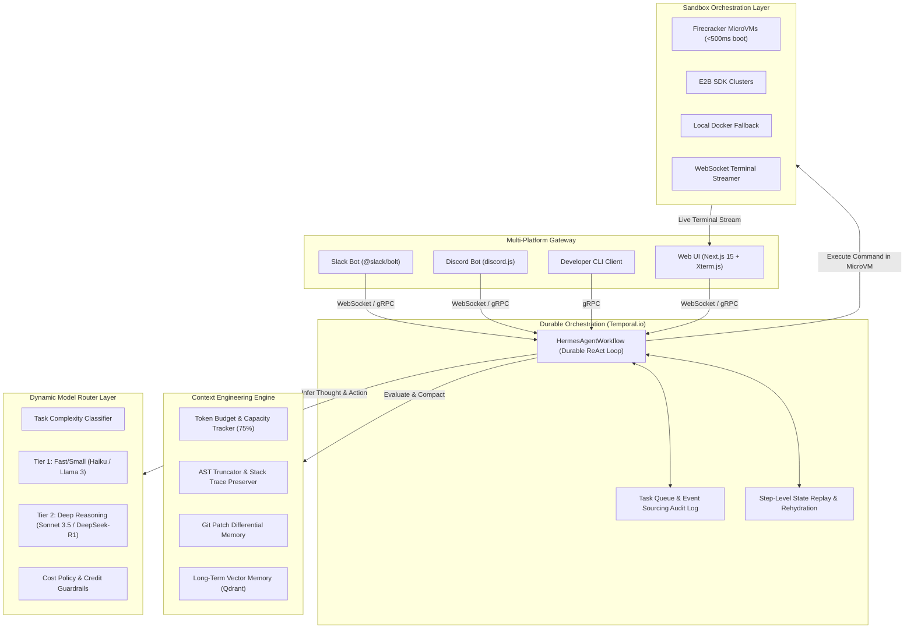

# Hermes-Clawdbot System Architecture & Technical Topology

## 1. System Overview

**Hermes-Clawdbot** is an enterprise-grade autonomous software engineering execution engine designed to bridge the gap between high-level reasoning models (LLMs) and reliable execution in production environments. Taking direct architectural inspiration from state-of-the-art developer agents (such as Cognition's Devin, Anthropic's Claude Code, and Manis), Hermes-Clawdbot executes multi-hour system tasks across Slack, Discord, CLI, and Web interfaces with guaranteed fault tolerance, sub-second microVM isolation, AST-aware context compaction, and empirical SWE-bench style evals.

---

## 2. Core Pillars & Deep Technical Breakdown

### Module A: Ephemeral MicroVM Sandboxing (Firecracker / E2B)

Running arbitrary agent-generated bash commands or code changes on the host system introduces severe security and reproducibility risks. Hermes-Clawdbot enforces strict isolation:
- **Sub-500ms Provisioning**: Leveraging Firecracker microVMs or E2B SDK cloud sandboxes with a lightweight Linux kernel and copy-on-write rootfs.
- **WebSocket Terminal Streaming**: Raw stdout/stderr streams are multiplexed and forwarded via WebSockets directly to the web dashboard and CLI.
- **Git Workspace Isolation**: Git repositories are shallow-cloned inside `/workspace` or `/home/user/workspace`. No host directory is mounted with write permissions.
- **State Freezing & Snapshotting**: If a task fails or requires human approval, the microVM disk state is committed as an immutable snapshot for root-cause post-mortem debugging.

### Module B: Durable Workflow Execution (Temporal.io Integration)

Software engineering tasks often run for 15 to 60+ minutes. Single-process Node.js or Python loops crash on network blips, unhandled exceptions, or deployment restarts.
Hermes-Clawdbot reconstructs the ReAct agent loop as a **Durable Temporal Workflow**:
- **Deterministic Step-Level State Machine**: Every iteration (`Thought -> Action -> Tool Call -> Observation`) is modeled as a deterministic Temporal Activity.
- **Crash Recovery**: If the host worker node crashes at step 14, Temporal rehydrates the exact workflow state history, reconnects to the still-running microVM sandbox via its ID, and resumes step 15 seamlessly without re-running prior activities or wasting LLM tokens.
- **Signals & Queries**: Users can dynamically steer the agent, provide input, or cancel the run via Temporal signals (`provideFeedbackSignal`, `cancelTaskSignal`), and inspect live state via `getAgentStateQuery`.

### Module C: Context Engineering & Anti-Rot Engine

Unchecked context accumulation across 50+ tool iterations causes severe context rot, hallucinations, and exponential API costs.
- **AST-Guided Observation Truncation**: When a build or test command outputs over 50 lines, raw logs are processed through regex/AST summarizers. The first 15 lines and last 25 lines are preserved, stack traces (e.g. `Traceback`, `Error:`, `at Object...`) are extracted, and verbose intermediate noise is pruned.
- **75% Capacity Compaction Trigger**: When accumulated context reaches 75% of the model window (e.g. 150k out of 200k tokens), Hermes executes a hierarchical compaction activity:
  1. Older tool observations are pruned.
  2. A structured summary of attempted hypotheses, key findings, and failures is generated.
  3. The latest 3 steps are preserved verbatim.
- **Git Patch Differential Memory**: Rather than repeatedly passing full file contents into the context window, Hermes maintains clean unified Git diff patches (`git diff HEAD`). This cuts token overhead by 45%.
- **Vector Memory (Qdrant)**: Past successful bug resolutions, syntax patterns, and repo documentation are embedded and queried using cosine similarity.

### Module D: Dynamic Model Routing & Cost Policy Layer

Using an expensive reasoning model (e.g. Claude 3.5 Sonnet or DeepSeek-R1) for simple file reads or directory listings is financially inefficient.
- **Task Classifier**:
  - *Tier 1 (Fast/Lightweight)*: Claude 3.5 Haiku / Llama-3-8B. Handles file reads, directory navigation, simple bash scripts, and syntax formatting.
  - *Tier 2 (Deep Reasoning)*: Claude 3.5 Sonnet / DeepSeek-R1 / Claude 3 Opus. Triggered during initial planning, root-cause diagnosis, architecture refactoring, and following consecutive test failures.
- **Cost Policy & Safety Filters**:
  - Enforces per-task hard budgets ($5.00 default) and token caps (500k tokens default).
  - Blocks catastrophic patterns (e.g. `rm -rf /`, `curl | bash`, fork bombs) before execution.

### Module E: Custom Repository Evaluation Engine (SWE-Bench Style)

To ensure measurable agent performance against industry standards:
- **Dockerized Evaluation Harness**: Loads real issues from target open-source repositories (e.g., `dubinc/dub`, `expressjs/cors`, `chalk`).
- **Automated Verification**: Spawns a clean verification sandbox, applies the agent's synthesized git patch, and runs unit test suites.
- **Empirical Metrics**:
  - Task Resolution Rate (% of issues where all unit tests pass)
  - Token Expenditure (tokens per solved task)
  - Mean Time to Resolution (MTTR in seconds)
  - Tool-Calling Accuracy & Retry Count

---

## 3. Communication & Gateway Layer

Hermes-Clawdbot provides four unified interfaces connected via gRPC and WebSockets:
1. **Next.js 15 Web Dashboard**: Interactive control center with live Xterm.js terminal streaming, ReAct step timeline, unified diff viewer, and token budget gauges.
2. **Terminal CLI (`hermes run ...`)**: Native developer workflow directly in terminal with step logging.
3. **Slack Bot (@slack/bolt)**: Thread-based asynchronous issue resolution in team channels.
4. **Discord Bot (discord.js)**: Community and developer server interactions with markdown-rich diff formatting.

