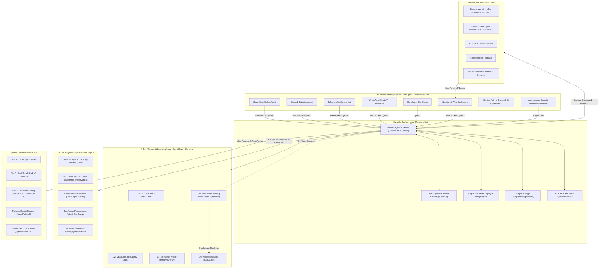

# Hermes-Clawdbot System Architecture & Technical Topology

## 1. System Overview

**Hermes-Clawdbot** is an enterprise-grade autonomous software engineering execution engine. It bridges the multi-channel gateway & file-based memory of **OpenClaw (formerly Clawdbot by Peter Steinberger)** with the self-improving **learning loop of Nous Research's Hermes Agent**, while solving their fatal security and durability flaws using **Firecracker/E2B microVM isolation** and **Temporal.io durable workflow event sourcing**.

---

## 2. Core Technical Modules & Deep Specifications

### Module A: Sub-500ms MicroVM Sandboxing (`packages/sandbox`)
- **Firecracker REST API Engine**:
  - Boot source configured via `PUT /boot-source` with uncompressed `vmlinux.bin`.
  - Ephemeral copy-on-write sparse file rootfs (`PUT /drives/rootfs`), ensuring zero mutation of base images and sub-10ms resets.
  - Vsock communication over CID 3 / Port 52 (`PUT /vsock`), multiplexing raw bash execution frames (`EXEC`, `OUT`, `ERR`, `EXIT`) with zero SSH daemon overhead.
- **Security & Cgroups V2 Isolation**:
  - Strict limits: 2 vCPUs, 2048 MB RAM, dropped Linux capabilities, network namespace TAP isolation with private subnet packet drop rules.
- **Post-Mortem Snapshots**:
  - Automatically captures microVM memory and disk snapshots (`PUT /snapshot/create`) upon task failure or crash for root-cause analysis.

### Module B: Durable Workflow Orchestration & Saga Pattern (`packages/agent-core`)
- **Deterministic Step-Level ReAct Loop**:
  - Models every cycle (`Thought -> Action -> Tool Call -> Observation`) as an immutable Temporal Activity.
  - If a worker node crashes at step 14, Temporal rehydrates the exact workflow history, reconnects to the active microVM sandbox via its ID, and resumes step 15 seamlessly without re-running prior activities or wasting LLM tokens.
- **Temporal Saga Pattern**:
  - Catches workflow failures and triggers `compensatingTransactionsActivity`: creates an autopsy disk snapshot, writes a post-mortem to episodic memory, and gracefully destroys the microVM.
- **Human-in-the-Loop Approval Gates**:
  - Sensitive operations (`git push`, `rm -rf`, production deployments) trigger an interactive approval halt.
  - The workflow suspends and waits for `approveExecutionSignal` from Slack / Discord / Web / CLI.

### Module C: Context Engineering & Anti-Rot Engine (`packages/context-engine`)
- **CodeSkeletonExtractor**:
  - Extracts structural syntax (classes, functions, interfaces, types) while eliding implementation details across TypeScript, JavaScript, Python, Go, and Rust. Reduces codebase scanning token footprint by **70%**.
- **TestFailureParser**:
  - Specialized parsers for Jest/Vitest, Pytest, Go test, and Cargo test that suppress passing tests and isolate exact assertion diffs (`Expected: ... Received: ...`) and failure stack traces.
- **Observation Truncator**:
  - Enforces a strict 50-line ceiling on all command outputs, stripping compiler noise while keeping diagnostic stack traces.
- **Git Patch Differential Memory**:
  - Maintains code changes as unified Git diff patches (`git diff HEAD`) rather than repeatedly feeding entire modified files into LLM context, saving **45%** on token overhead.
- **Qdrant Vector Memory**:
  - Long-term semantic code search over past resolutions and documentation using 1536-dimensional embeddings.

### Module D: Dynamic Model Routing & Cost Policy Layer (`packages/model-router`)
- **Task Classifier**:
  - **Tier 1 (Fast / Routine)**: Claude 3.5 Haiku / Llama-3.3-70B for file reads, directory inspection, syntax formatting, and routine bash scripts.
  - **Tier 2 (Deep Reasoning)**: Claude 3.5 Sonnet / DeepSeek-R1 for strategy planning, complex bug diagnosis, and multi-file refactoring.
- **Failover Circuit Breaker**:
  - Automatically redirects requests to secondary fallback providers upon detecting 3 consecutive rate-limit (429) or server overload (5xx) responses.
- **Prompt Security Scanner**:
  - Scans user prompts for instruction overrides, jailbreak attempts, host probing, and obfuscated payloads before dispatching to LLM APIs.

### Module E: OpenClaw Universal Gateway Control Plane (`packages/gateway`)
- **JSON-RPC 2.0 WebSocket Daemon (`ws://127.0.0.1:18789`)**:
  - Central control plane matching OpenClaw's standard protocol.
  - Exposes typed RPC methods: `task.submit`, `task.cancel`, `task.pause`, `task.resume`, `task.approve`, `state.query`, `memory.get`, `skills.list`.
- **Device Pairing Authentication**:
  - Implements 6-digit pairing code generation and HMAC-SHA256 signature verification for external nodes, mobile devices, and remote webhooks.
- **Multi-Platform Channel Adapters**:
  - Slack Bot (`@slack/bolt`) with Block Kit interactive approval buttons.
  - Discord Bot (`discord.js`) with ActionRow buttons and embeds.
  - Telegram Bot (`grammY`) with command routing and inline keyboards.
  - WhatsApp Cloud API webhook listener with `hub.challenge` handshake.
- **Autonomous Scheduler**:
  - Recurring Cron scheduler and silent Heartbeat daemon with anomaly gating to avoid notification spam.

### Module F: 4-Tier Memory & Self-Evolution Learning Loop (`packages/memory`)
- **File-Based Memory Hierarchy**:
  - `SOUL.md`: Agent core identity and operational directives.
  - `USER.md`: User preferences, active projects, tech stack conventions.
  - `MEMORY.md`: Long-term verified factual knowledge.
  - `memory/YYYY-MM-DD.md`: Daily episodic logs with session-kind write gating.
- **Nous Research Self-Evolution Learning Loop**:
  - Post-turn reflection activity (`HermesLearningLoop`) that analyzes completed trajectories and synthesizes reusable **`SKILL.md`** playbooks into the progressive disclosure catalog upon solving novel engineering tasks.

### Module G: SWE-Bench Evaluation Harness (`packages/eval-suite`)
- **Automated Verification Harness**:
  - Loads benchmark cases from real repositories (e.g. `dubinc/dub`, `expressjs/cors`, `chalk`).
  - Spawns an isolated verification container, applies the agent's synthesized patch, and runs target test suites.
  - Reports pass@1 resolution rate, mean time to resolution, token efficiency, and total cost.
